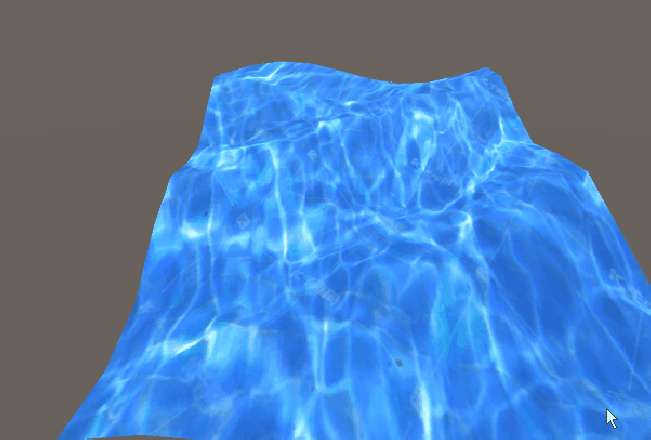

# Unity 正弦波流体模拟

Unity 网格变形实验：以解析正弦函数驱动平面网格顶点的高度，形成连续传播的水面起伏。当前保留可运行的 Windows 历史成品、GIF 演示与实验报告；原始 Unity 工程和 C# 源码未能找回，因此不把本项目表述为可编辑的源码工程。

## 原理与实现要点

实验报告记录的实现先构建规则网格及三角面索引，再在每帧按下式更新每个顶点的 Y 坐标：

`y = 0.2 * sin(1.5 * x + 1.5 * z + time)`

这是一种**解析式、位移驱动**的波面，而非求解流体压力、速度场或体积守恒的通用流体求解器。它的核心价值在于以较低成本演示运行时 Mesh 顶点变形、规则网格拓扑、UV/法线配置与逐帧渲染更新。

## 与布料模拟的关联

本项目与[Unity 布料模拟](../unity-cloth-simulation/)共享同一条技术主线：两者都直接操作规则网格顶点，并依赖三角形拓扑与法线来保持实时可见的表面形状和光照结果。

差别在运动模型：本项目以时间和位置的正弦函数直接给出顶点高度，因此稳定、可预测且适合风格化水面；布料项目则维护速度、重力、阻尼、边长约束、固定点和球体碰撞，通过迭代求解得到形变。前者是程序化表面动画，后者是受约束的动力学近似。

## 运行与材料

- Windows：下载后运行 `windows/start.bat`；
- [实验报告](docs/sin-wave-fluid-report.pdf)记录了网格构建和正弦位移公式；
- `media/sin-wave-demo.gif` 是项目演示；
- 原始工程与源码缺失，现有二进制仅作为历史可运行成品保存。
